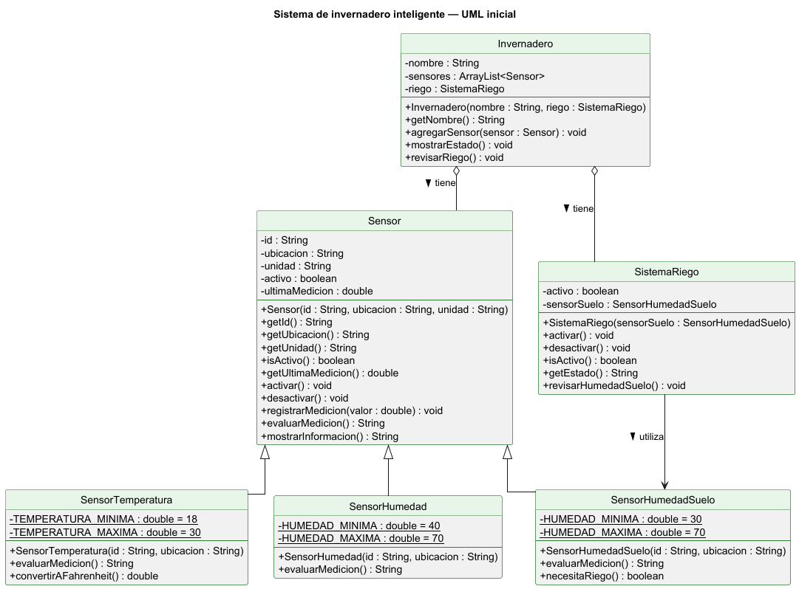

# Análisis y diseño

# Análisis y diseño

## 1. Descripción del problema

### Qué sistema se va a representar

Un invernadero inteligente. 

El invernadero tiene tres sensores: uno mide la temperatura del aire, otro la humedad del ambiente y otro la humedad del suelo. También tiene un sistema de riego.

La idea es que el programa lea lo que marca cada sensor, diga si ese valor está bajo, adecuado o alto, y si el suelo está seco, prenda el riego.

### Qué información necesita manejar

De cada sensor: su identificador, dónde está instalado, si está activo o inactivo y lo que midió.

La unidad medición: °C para la temperatura y % para las dos humedades.

Rangos de cada sensor, para saber si un valor es bajo, adecuado o alto.

Sistema de riego: si está activo o inactivo.

### Qué elementos intervienen

Sensor de temperatura del aire 

Sensor de humedad ambiental

Sensor de humedad del suelo

Sistema de riego 

### Qué operaciones generales debe realizar

Medir cada sensor

Consultar la medición de un sensor

Interpretar la medición, si está baja, adecuada o alta

Activar o desactivar un sensor

Activar o desactivar el riego y consultar su estado

Decidir si se riega o no según la humedad del suelo

Mostrar cómo está todo el invernadero en un momento dado

## 2. Identificación de objetos

### Sensor

**Qué representa.** un sensor del invernadero, sin importar qué mida.

**Por qué debe existir como objeto.** Porque los tres sensores tienen los mismos datos (identificador, ubicación, estado y medición) y hacen cosas parecidas. Si no existe, habría que repetir lo mismo en cada tipo de sensor.

**Qué responsabilidad tendría.** Guardar lo que todos los sensores tienen en común y permitir conocer su medición.

### Sensor de temperatura

**Qué representa.** El sensor que mide la temperatura del aire, en °C.

**Por qué debe existir como objeto.** Tiene su propia unidad y sus propios rangos, a diferencia de los otros sensores. Una temperatura de 30° aprox para este sensor es temperatura alta, pero para otro sensor es diferente.

**Qué responsabilidad tendría.** Medir la temperatura y decir si está baja, adecuada o alta.

### Sensor de humedad ambiental

**Qué representa.** El sensor que mide la humedad del aire, en %.

**Por qué debe existir como objeto.** Usa % igual que el del suelo, pero sus rangos son otros y mide algo diferente.

**Qué responsabilidad tendría.** Medir la humedad del aire y decir si está baja, adecuada o alta.

### Sensor de humedad del suelo

**Qué representa.** El sensor que mide qué tan húmedo o seco está el suelo, en %.

**Por qué debe existir como objeto.** Tiene sus propios rangos y además su lectura es la que se usa para decidir si se riega.

**Qué responsabilidad tendría.** Medir la humedad del suelo y decir si está baja, adecuada o alta.

### Sistema de riego

**Qué representa.** Se encarga de regar las plantas.

**Por qué debe existir como objeto.** Si no esta haciendo algo: riega. Tiene su propio estado, activo o inactivo y va cambiando.

**Qué responsabilidad tendría.** Prenderse, apagarse, decir si está regando o no, y decidir si debe regar usando lo que dice el sensor de humedad del suelo.

### Invernadero

**Qué representa.** El lugar donde están instalados los sensores y el sistema de riego.

**Por qué debe existir como objeto.** Por que es el que se encarga de leer todo y decidir que hacer 

**Qué responsabilidad tendría.** Tener los sensores y el riego, mostrar cómo está cada uno y pedirle al riego que revise si hace falta regar.

---

## 3. Estado y comportamiento

| Objeto propuesto            | Responsabilidad                                              | Información que debe conservar                                           | Comportamientos que debe realizar                                                                                                                                                   |
|-----------------------------|--------------------------------------------------------------|--------------------------------------------------------------------------|-------------------------------------------------------------------------------------------------------------------------------------------------------------------------------------|
| Sensor                      | Representar lo que tienen en común todos los sensores        | Identificador, ubicación, si está activo o inactivo y su última medición | Permite conocer su identificador, su ubicación y su última medición. Debe poder activarse, desactivarse y recibir una nueva medición.                                               |
| Sensor de temperatura       | Medir la temperatura del aire                                | Trabaja en °C con sus propios rangos                                     | Debe mostrar su medición en °C y decir si la temperatura está baja, adecuada o alta.                                                                                                |
| Sensor de humedad ambiental | Medir la humedad del aire                                    | Trabaja en % con sus propios rangos                                      | Debe mostrar su medición en % y decir si la humedad está baja, adecuada o alta.                                                                                                     |
| Sensor de humedad del suelo | Medir la humedad del suelo                                   | Trabaja en % con sus propios rangos                                      | Debe mostrar su medición en % y decir si la humedad está baja, adecuada o alta. Debe permitir saber si el suelo está seco para el riego.                                            |
| Sistema de riego            | Regar las plantas cuando haga falta                          | Si está activo o inactivo y el sensor de humedad del suelo que usa       | Debe poder activarse, desactivarse y decir su estado. Debe revisar lo que dice el sensor del suelo y activarse si la humedad está baja, o quedarse apagado si está adecuada o alta. |
| Invernadero                 | Juntar todos los elementos y revisar el invernadero completo | Los sensores instalados y el sistema de riego                            | Debe permitir agregar sensores, mostrar la medición e interpretación de cada sensor y pedirle al riego que revise si hace falta regar.                                              |

## 4. Características comunes y especialización

### Qué información tienen en común

Los tres sensores tienen un identificador, una ubicación, un estado y una medición.

### Qué comportamientos tienen en común

Todos pueden dar su medición, activarse, desactivarse, mostrar sus datos e interpretar lo que midieron.

### Qué cambia dependiendo del tipo de sensor

Lo que cambia es qué miden, en qué unidad y cómo interpretan el número:

Por eso el mismo número no significa lo mismo en todos. Un 30° es temperatura alta, humedad ambiental baja y humedad del suelo adecuada. Todos interpretan su medición, pero cada uno a su manera.

### ¿Existe un concepto general que represente a todos los sensores?

El Sensor. Ahí va todo lo que comparten: identificador, ubicación, estado y medición. Así eso se escribe una sola vez.

### ¿Qué elementos podrían ser especializaciones?

El sensor de temperatura, el de humedad ambiental y el de humedad del suelo. Los tres son sensores, pero cada uno tiene su unidad y su forma de interpretar.

Aunque los dos de humedad usan %, no conviene juntarlos en uno solo, porque sus rangos son diferentes y miden cosas distintas.

---

## 5. Relaciones entre objetos

### Relaciones ES UN

Un sensor de temperatura ES UN sensor.

Un sensor de humedad ambiental ES UN sensor.

Un sensor de humedad del suelo ES UN sensor.

Estas sí se podrían representar con herencia, porque los tres tienen todo lo de un sensor y nada más cambian cómo interpretan su medición.

### Relaciones TIENE / UTILIZA UN

El invernadero TIENE sensores.

El invernadero TIENE un sistema de riego.

El sistema de riego UTILIZA el sensor de humedad del suelo.

Estas no deben ser herencia. El invernadero no es un sensor ni un sistema de riego, solo los contiene. 

### Qué objetos colaboran y qué información necesitan

Sistema de riego con sensor de humedad del suelo.

Invernadero con los sensores.

Invernadero con el sistema de riego.

### Qué responsabilidades no deben duplicarse

Interpretar la medición le toca solo al sensor. El riego no debe volver a revisar si 22 % es bajo, se lo pregunta al sensor.

Los datos que comparten los sensores se guardan en el sensor general, no se repiten en cada tipo.

Activar o apagar el riego le toca solo al sistema de riego. El sensor mide, pero no prende el riego.

### ¿Por qué SistemaRiego no debería ser una subclase de Sensor?

Porque el sistema de riego no es un sensor, el sensor observa, el sistema de riego actúa.

El riego no tiene medición, ni unidad, ni rangos que interpretar. Si heredara de Sensor, se quedaría con cosas que no usa y se mezclarían dos trabajos diferentes.

---

# Fase 2. Diseño orientado a objetos

---

## 6. Diseño de clases

| Clase | Atributos propuestos | Tipo de dato | Métodos propuestos | Responsabilidad |
|---|---|---|---|---|
| `Sensor` | `id` `ubicacion` `unidad` `activo` `ultimaMedicion` | `String` `String` `String` `boolean` `double` | `Sensor(id, ubicacion, unidad)` `getId()`, `getUbicacion()`, `getUnidad()` `isActivo()`, `getUltimaMedicion()` `activar()`, `desactivar()` `registrarMedicion(valor)` `evaluarMedicion()` `mostrarInformacion()` | Guardar lo que tienen en común todos los sensores y dar una forma general de interpretar la medición. |
| `SensorTemperatura` | `TEMPERATURA_MINIMA` `TEMPERATURA_MAXIMA` | `double` (constante, 18) `double` (constante, 30) | `SensorTemperatura(id, ubicacion)` `evaluarMedicion()` `convertirAFahrenheit()` | Medir la temperatura del aire en °C y decir si está baja, adecuada o alta. |
| `SensorHumedad` | `HUMEDAD_MINIMA` `HUMEDAD_MAXIMA` | `double` (constante, 40) `double` (constante, 70) | `SensorHumedad(id, ubicacion)` `evaluarMedicion()` | Medir la humedad ambiental en % y decir si está baja, adecuada o alta. |
| `SensorHumedadSuelo` | `HUMEDAD_MINIMA` `HUMEDAD_MAXIMA` | `double` (constante, 30) `double` (constante, 70) | `SensorHumedadSuelo(id, ubicacion)` `evaluarMedicion()` `necesitaRiego()` | Medir la humedad del suelo en %, decir si está baja, adecuada o alta y avisar si hace falta regar. |
| `SistemaRiego` | `activo` `sensorSuelo` | `boolean` `SensorHumedadSuelo` | `SistemaRiego(sensorSuelo)` `activar()`, `desactivar()` `isActivo()`, `getEstado()` `revisarHumedadSuelo()` | Prender y apagar el riego y decidir si riega usando lo que dice el sensor de humedad del suelo. |
| `Invernadero` | `nombre` `sensores` `riego` | `String` `ArrayList<Sensor>` `SistemaRiego` | `Invernadero(nombre, riego)` `getNombre()` `agregarSensor(sensor)` `mostrarEstado()` `revisarRiego()` | Juntar los sensores y el riego, mostrar cómo está cada sensor y pedirle al riego que revise si hace falta regar. |

### Qué atributos necesita cada clase

**Sensor.** id, ubicacion, unidad, activo y ultimaMedicion. 

**SensorTemperatura.** Solo sus rangos: TEMPERATURA MINIMA y TEMPERATURA MAXIMA. 

**SensorHumedad.** Solo sus rangos: HUMEDAD MINIMA y HUMEDAD MAXIMA.

**SensorHumedadSuelo.** Solo sus rangos: HUMEDAD MINIMA y HUMEDAD MAXIMA.

**SistemaRiego.** activo, para saber si está regando, y sensorSuelo, que es el sensor de humedad del suelo que revisa.

**Invernadero.** nombre, sensores, que es la lista con todos los sensores, y riego.

### Qué atributos deben ser private

Todos. Así nadie de afuera los cambia directo, solo con los métodos de la clase.

### Qué información se recibe en el constructor

**Sensor.** Recibe id, ubicacion y unidad. activo empieza en true y ultimaMedicion en 0, así que no se piden.

**Las tres subclases.** Solo reciben id y ubicacion. 

**SistemaRiego.** Recibe el sensor de humedad del suelo que va a usar. Empieza apagado.

**Invernadero.** Recibe su nombre y su sistema de riego. La lista de sensores empieza vacía y se va llenando con agregarSensor().

### Qué operaciones se hacen con métodos

**Sensor.** activar() y desactivar() para cambiar su estado. registrarMedicion(valor) para guardar una medición simulada. evaluarMedicion() para interpretar la medición; en Sensor solo regresa un texto general. mostrarInformacion() para regresar todos sus datos juntos con la interpretación.

**Subclases.** Cada una vuelve a escribir evaluarMedicion() con sus propios rangos. SensorTemperatura agrega convertirAFahrenheit() y SensorHumedadSuelo agrega necesitaRiego(), que dice si la humedad está debajo de 30 %.

**SistemaRiego.** activar() y desactivar() para prenderlo y apagarlo. revisarHumedadSuelo() le pregunta al sensor necesitaRiego() y según eso se prende o se apaga.

**Invernadero.** agregarSensor(sensor) para meter sensores a la lista, mostrarEstado() para mostrar todos los sensores y revisarRiego() para pedirle al riego que revise.

### Qué información se puede consultar desde otras clases

**Sensor.** Su id, ubicación, unidad, si está activo y su última medición, con getId(), getUbicacion(), getUnidad(), isActivo() y getUltimaMedicion().

**SistemaRiego.** Su estado, con isActivo() y getEstado(), que regresa "ACTIVO" o "INACTIVO".

**Invernadero.** Su nombre, con getNombre().

### Qué va en la clase general

En Sensor va todo lo que comparten los tres sensores: id, ubicacion, unidad, activo y ultimaMedicion, sus getters, activar(), desactivar(), registrarMedicion() y mostrarInformacion(). 

### Qué va solo en las clases especializadas

Sus rangos, porque cada tipo tiene los suyos.

---

## 7. Jerarquía de clases

### Qué clases forman una misma jerarquía

Sensor, SensorTemperatura, SensorHumedad y SensorHumedadSuelo. Sensor es la superclase y las otras tres son subclases, porque cada una ES UN sensor.

### Qué clases solo colaboran

SistemaRiego no es un sensor, entonces no entra en la jerarquía. El sensor observa y el riego actúa. 

El riego guarda un SensorHumedadSuelo y no un Sensor cualquiera, porque solo la humedad del suelo decide si se riega y solo ese sensor tiene necesitaRiego().

Invernadero tampoco hereda de nada. 

### Cómo evité duplicar información

Los datos comunes (id, ubicación, unidad, estado y medición) solo están en Sensor.

mostrarInformacion() también está una sola vez en Sensor y lo usan los tres tipos.

En las subclases solo quedó lo que es propio de cada una: sus rangos, su evaluarMedicion() y, en dos de ellas, su método extra.

-------

## 8. Diagrama UML inicial

Cómo leer el diagrama:

- `-` es privado y `+` es público.
- Los atributos subrayados son `static` (las constantes de los rangos).
- La flecha con triángulo vacío es herencia (**ES UN**).
- La línea con rombo vacío es "tiene" (el invernadero tiene sensores y un sistema de riego).
- La flecha normal de `SistemaRiego` a `SensorHumedadSuelo` es "utiliza".

El código fuente del diagrama está en `uml-inicial.puml` (PlantUML), por si hay que modificarlo después.

---

## 9. Justificación del diseño

**1. ¿Por qué propusiste esas clases?**

Salen de los objetos que identifiqué en la sección 2. Hay un sensor general, tres tipos de sensor porque cada uno interpreta su medición diferente, un sistema de riego porque es el único que actúa, y un invernadero que junta todo para poder revisarlo completo.

**2. ¿Cuál es la responsabilidad principal de cada una?**

- `Sensor`: guardar los datos comunes de cualquier sensor.
- `SensorTemperatura`: interpretar la temperatura del aire.
- `SensorHumedad`: interpretar la humedad ambiental.
- `SensorHumedadSuelo`: interpretar la humedad del suelo y decir si hace falta regar.
- `SistemaRiego`: prender o apagar el riego.
- `Invernadero`: tener todos los sensores y el riego y mostrar el estado completo.

**3. ¿Por qué determinados atributos serán `private`?**

Para que nadie los cambie sin control. 

**4. ¿Qué información proporcionarás mediante los constructores?**

Lo que necesita un objeto para existir. A los sensores se les da su `id` y su `ubicacion`; la unidad la pone cada subclase sola. Al sistema de riego se le da el sensor de suelo que va a usar. Al invernadero se le da su nombre y su sistema de riego. El estado y la medición no se piden: los sensores empiezan activos con medición 0 y el riego empieza apagado.

**5. ¿Cuál será la superclase?**

`Sensor`.

**6. ¿Qué clases serán subclases?**

`SensorTemperatura`, `SensorHumedad` y `SensorHumedadSuelo`.

**7. ¿Por qué existe una relación "es un" entre ellas?**

Los tres tienen identificador, ubicación, estado y medición, y los tres interpretan lo que miden. Lo único que cambia es la unidad y los rangos.

**8. ¿Qué información o comportamiento decidiste colocar en la superclase?**

(`id`, `ubicacion`, `unidad`, `activo`, `ultimaMedicion`), sus *getters*, `activar()`, `desactivar()`, `registrarMedicion()` y `mostrarInformacion()`, porque funcionan igual para cualquier sensor.

**9. ¿Qué elementos permanecerán en las subclases?**

- Sus rangos, porque son el criterio propio de cada tipo de sensor.
- `evaluarMedicion()`.
- `convertirAFahrenheit()` solo en `SensorTemperatura`
- `necesitaRiego()` solo en `SensorHumedadSuelo`, porque es el único sensor que decide el riego.

**10. ¿Por qué `SistemaRiego` no pertenece a la jerarquía de sensores?**

Porque no es un sensor. El sensor observa y el sistema de riego actúa. El riego no tiene medición, ni unidad, ni rangos, así que si heredara de `Sensor` tendría atributos y métodos que no usa. 

**11. ¿Qué decisiones tomaste para evitar duplicar responsabilidades?**

- Los datos comunes están una sola vez, en `Sensor`.
- `mostrarInformacion()` está una sola vez, en `Sensor`, y lo heredan todos.
- Cada sensor es el único que sabe interpretar su medición. El riego no revisa si 22 % es bajo; le pregunta al sensor con `necesitaRiego()`.
- Solo `SistemaRiego` prende o apaga el riego. El sensor y el invernadero no cambian su estado directamente.